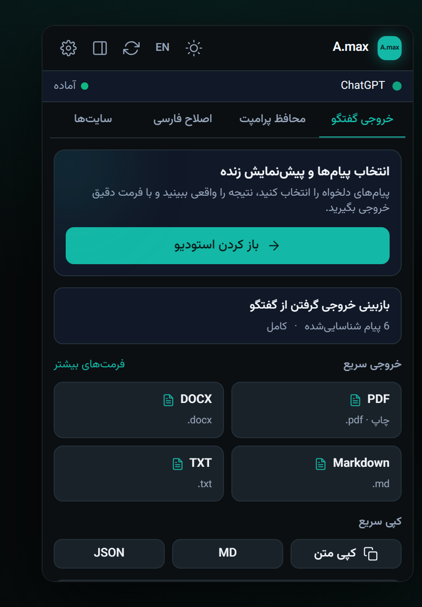
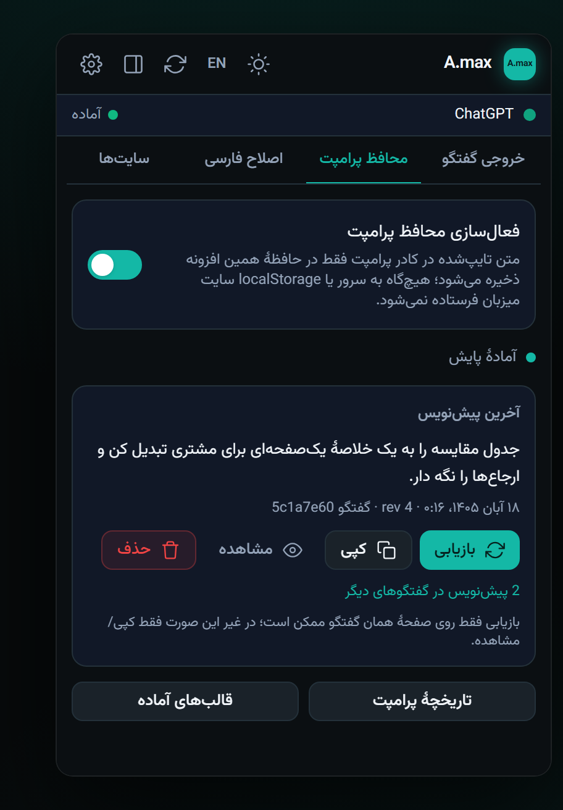
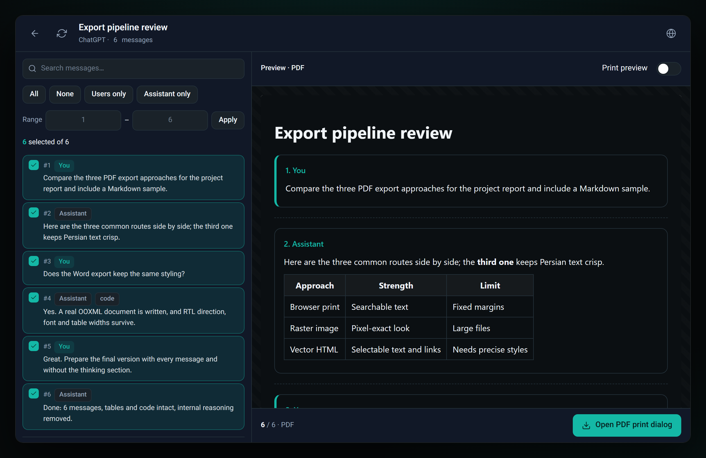
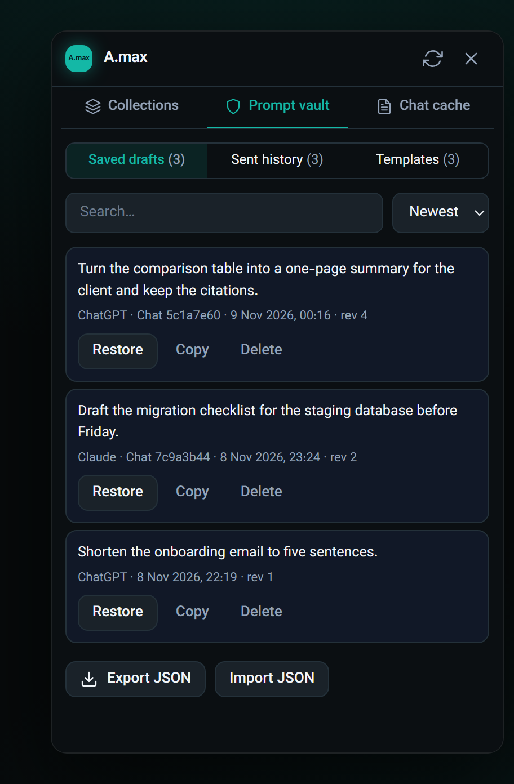
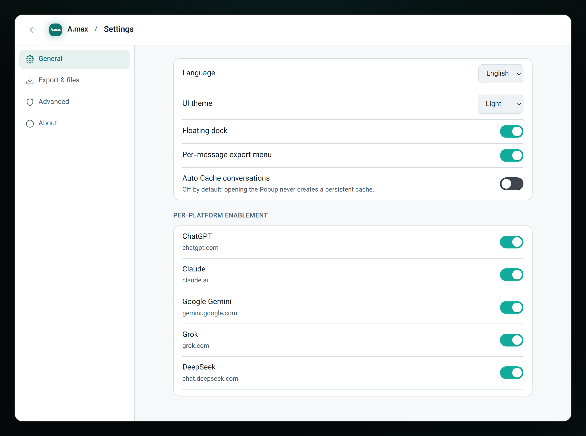

# A.max — افزونهٔ کروم

<p>
  
  <a href="./README.md"></a>
</p>

<p>
  <a href="https://github.com/arashmakkyy/a-max/actions/workflows/ci.yml"></a>
  <a href="https://github.com/arashmakkyy/a-max/releases/latest"></a>
  <a href="./LICENSE"></a>
  
  
</p>

A.max یک افزونهٔ متن‌باز و محلی برای کسانی است که بیشتر وقتشان را داخل پنجرهٔ گفتگوی هوش مصنوعی
می‌گذرانند. گفتگو را به PDF، Word، Markdown، PNG، JSON، TXT، HTML یا CSV تبدیل می‌کند، به هر پاسخ یک
دکمهٔ خروجی کوچک اضافه می‌کند، پیش‌نویس پرامپت هر گفتگو را جدا و سرِ جای خودش نگه می‌دارد و متن فارسی و
راست‌به‌چپ را در ChatGPT، Claude، Gemini، DeepSeek، Qwen، Grok، Perplexity، Kimi، Poe، Copilot و ۱۰
سایت دیگر (در مجموع ۲۰ سایت) اصلاح می‌کند. بدون حساب کاربری، بدون سرور، بدون ردیابی.

**نسخه:** ۱.۲.۰ · **سازنده:** آرش مکّی · **پروانه:** MIT  
**رابط کاربری:** React 19 + Vite 7 + Tailwind 4، پیش‌فرض فارسی و راست‌به‌چپ، با گزینهٔ انگلیسی.

> **وضعیت انتشار:** نسخهٔ قابل نصب برای توسعه، نه یک انتشار عمومی تأییدشده.
> فایل [TEST_REPORT.md](./TEST_REPORT.md) فهرست می‌کند چه آزمونی واقعاً اجرا شده و چه چیزی هنوز باز است؛
> [DELIVERY_REPORT.md](./DELIVERY_REPORT.md) هم گزارش مورد‌به‌مورد تحویل است. هیچ‌کدام داخل فایل ZIP
> نصبی نیستند.

## تصاویر

| Popup — خروجی | Popup — محافظ پرامپت |
|---|---|
|  |  |

| استودیوی پیش‌نمایش و خروجی | گنجینهٔ پرامپت (پنل کناری) |
|---|---|
|  |  |



*این تصاویر از باندل تولیدی و از طریق یک هارنس با `chrome.*` تقلیدی در مقیاس ۲× گرفته شده‌اند، نه از
نصب unpacked در یک پروفایل واقعی کروم.*

## نصب

**از نسخهٔ منتشرشده (بدون Build):** فایل `a-max-1.2.0.zip` را از
[آخرین انتشار](https://github.com/arashmakkyy/a-max/releases/latest) بگیرید. پس از استخراج، یک پوشهٔ
`a-max-<version>` به دست می‌آید.

**از مخزن (این هم Build نمی‌خواهد، چون `dist/` کامیت شده است):** همان پوشه‌ای را انتخاب کنید که
`manifest.json` در آن است.

1. فایل ZIP را استخراج کنید یا مخزن را clone کنید.
2. در کروم `chrome://extensions` و در Edge `edge://extensions` را باز کنید.
3. **Developer mode** را روشن کنید.
4. **Load unpacked** را بزنید و پوشه‌ای را که `manifest.json` دارد انتخاب کنید.
5. یکی از صفحات پشتیبانی‌شدهٔ چت را باز کنید، یک‌بار صفحه را نوسازی کنید و روی آیکون A.max بزنید.

افزونه رابط کاربری آمادهٔ خود را از `dist/` بارگذاری می‌کند که داخل بسته هست؛ پس **برای نصب هیچ Build
لازم نیست**.

## ساخت دوبارهٔ رابط کاربری

رابط در `app/` است و در `dist/` ساخته می‌شود:

```bash
cd app
npm install
npm run build
```

`npm run build` ابتدا `scripts/sync-engine.mjs` را اجرا می‌کند؛ این اسکریپت موتور مشترک خروجی
(`src/engine/*.js` و `src/shared/engine-bridge.js`) را در `app/public/engine` کپی می‌کند تا صفحات افزونه
و اسکریپت محتوا همیشه یک کد را اجرا کنند. خروجی Build شامل `dist/index.html`، `dist/assets/*`،
`dist/engine/*` و `dist/fonts/*` است. یک صفحه همهٔ ورودی‌ها را با hash/query سرو می‌کند:
`#popup`، `#studio`، `#sidepanel`، `#settings` (یا `?surface=...`).

## امکانات این نسخه

- **رابط تازه در همه‌جا:** پاپ‌آپ، استودیوی پیش‌نمایش، پنل کناری، صفحهٔ تنظیمات و داک درون‌صفحه همه از
  رابط React استفاده می‌کنند (تم تیرهٔ کربنی/فیروزه‌ای، فارسی راست‌به‌چپ، کارت ۴۰۰×۶۰۰ برای پاپ‌آپ).
- **برداشت زنده:** پاپ‌آپ و پنل کناری هنگام باز شدن، گفتگوی تب فعال را می‌خوانند؛ استودیو می‌تواند تب
  مبدأ خودش را دوباره بخواند یا برداشت تازهٔ داک را بگیرد.
- **کل گفتگو، حتی پیش از اسکرول:** برای ChatGPT، Claude، DeepSeek و Qwen برداشت ابتدا کل درخت پیام‌ها را
  از API خود سایت با اعتبار نشست می‌خواهد، آن را با آنچه صفحه رندر کرده ادغام می‌کند (تا کدها و تصویرها
  حفظ شوند) و بعد لیست مجازی را می‌پیماید تا پیام‌های تنبل‌ساز هم سوار شوند. اگر API جواب ندهد، برداشت
  بی‌صدا به صفحه برمی‌گردد.
- **منوی خروجی درون چت:** روی هر پاسخ یک آیکون ۲۷ پیکسلی در نوار عملیات ظاهر می‌شود که یک پاپ‌اور
  هماهنگ با تم باز می‌کند: PDF، Word، Markdown، PNG، «کپی تصویر این پاسخ»، کپی Markdown و افزودن به پنل
  کناری — با پشتیبانی کیبورد و صفحه‌خوان، و portal‌شده تا هیچ کادر پیامی آن را نبُرد.
- **هشت فرمت خروجی:** PDF، فایل واقعی OOXML با پسوند `.docx`، Markdown، PNG (تصویر بلند، در صورت نیاز
  تقسیم‌شده در ZIP)، JSON، TXT، HTML و CSV — به‌همراه کپی به‌صورت Markdown / TXT / JSON.
- **PDF قابل جست‌وجو:** سند HTML برداری از طریق `src/print/print.html` چاپ می‌شود؛ در پنجرهٔ چاپ
  «Save as PDF» را انتخاب کنید.
- **فونت وزیرمتن میزبانی‌شده** (`app/public/fonts`، پروانهٔ OFL-1.1) — رابط و صفحهٔ چاپ آفلاین کار
  می‌کنند.
- **محافظ پرامپت، اصلاح دوسویهٔ فارسی، داک شناور و خروجی تک‌پیام** همگی به رکورد مشترک تنظیمات وصل‌اند،
  پس صفحهٔ تنظیمات React و ابزارهای درون‌صفحه همیشه هم‌خوان می‌مانند.
- **هر پیش‌نویس پرامپت به گفتگو یا تب خودش می‌چسبد:** گفتگوی باز با شناسهٔ گفتگو کلید می‌خورد
  (ChatGPT/Claude/Gemini/DeepSeek/Qwen/Kimi/Poe و…) و چت تازه با شناسهٔ همان تب در `sessionStorage`.
  ده تب که آدرس یکسان «چت جدید» دارند دیگر نمی‌توانند پیش‌نویس همدیگر را بازنویسی یا نمایش دهند؛ محافظ
  فقط پیش‌نویس تب فعال را نشان می‌دهد و لینک پیش‌نویس‌های دیگر را در گنجینه می‌دهد.
- **بستن داک سراسری است:** با × کردن داک، در همهٔ تب‌ها — حتی تب‌هایی که بعداً باز می‌شوند — پنهان
  می‌ماند تا وقتی از پاپ‌آپ «نمایش داک» را بزنید.
- **ذخیره‌سازی محلی:** تنظیمات، عکس‌های گفتگو، مجموعه‌ها، پیش‌نویس‌ها، تاریخچه و قالب‌ها در
  `chrome.storage.local` (زیر کلیدهای `amtool:v2:*`) می‌مانند. یک آینه از کلیدهای مشترک در رکورد قدیمی
  `am_tool_settings_v1` نوشته می‌شود تا اسکریپت محتوا همچنان کار کند.

## محدودیت‌های شناخته‌شده

- برداشت از سایت‌های واقعی برای پلتفرم‌های پشتیبانی‌شده پیاده‌سازی شده اما روی همهٔ آن‌ها **تأیید نشده**
  است؛ تغییر DOM در سایت میزبان هنوز می‌تواند استخراج را بشکند.
- آداپتورهای «کل تاریخچه» فقط با پاسخ‌های شبیه‌سازی‌شدهٔ API آزمایش شده‌اند؛ نشست واقعی
  ChatGPT/Claude/DeepSeek/Qwen در محیط سازنده در دسترس نبود. «کپی تصویر» هم با کلیپ‌بورد واقعی آزمایش
  نشده است.
- افزونه هنوز به‌صورت unpacked داخل یک پروفایل معمولی کروم توسط سازنده اجرا نشده است؛ باندل تولیدی،
  قراردادهای برداشت، دانلودها و محتوای چاپ در یک هارنس DOM و در Chromium بررسی شده‌اند
  (نگاه کنید به TEST_REPORT.md).
- گفتگوهای بسیار بلند به چند صفحهٔ PNG تقسیم و در یک ZIP دانلود می‌شوند.
- پیش‌نویسی که در یک **چت جدید و ارسال‌نشده** تایپ شده، به همان تب بسته است (از نوسازی صفحه و بازیابی
  نشست کروم جان سالم به در می‌برد). اگر تب پیش از آنکه سایت شناسهٔ گفتگو را بدهد بسته شود، پیش‌نویس در
  گنجینهٔ پرامپت می‌ماند و به‌طور خودکار در تب دیگری بازیابی نمی‌شود.
- وزیرمتن به‌صورت زیرمجموعه همراه است؛ نویسه‌های کم‌کاربرد به فونت سیستم برمی‌گردند.
- تطابق قالب‌بندی برای جدول‌های پیچیده، فرمول و تصویر باید برای هر سایت و هر فرمت جداگانه بررسی شود.

## امنیت و حریم خصوصی

هیچ حساب کاربری و هیچ سروری در کار نیست. گفتگوها، پیش‌نویس‌ها و تنظیمات فقط در حافظهٔ افزونه روی همین
دستگاه می‌مانند. HTML خروجی پاک‌سازی می‌شود و با CSP سخت‌گیرانه سرو می‌شود؛ صفحهٔ چاپ فقط فونت همراه را
به‌صورت data URL در خود دارد. از Build تأییدنشده برای پرامپت‌های محرمانه بدون بازبینی خودتان استفاده
نکنید.

## مشارکت

گزارش باگ و Pull Request خوش‌آمد است — [CONTRIBUTING.md](./CONTRIBUTING.md) را ببینید. لطفاً متن گفتگوی
واقعی، توکن یا کوکی را در Issue نگذارید.

## پروانه

MIT © ۲۰۲۶ [آرش مکّی](https://github.com/arashmakkyy). فونت وزیرمتن همراه پروانهٔ OFL-1.1 دارد؛
`app/public/fonts` را ببینید.

## مراجع

- [سند نیازمندی اصلی این بازطراحی](./docs/PRD-Concept-1.md)
- [TEST_REPORT.md](./TEST_REPORT.md) — چه چیزی آزمایش شد و چه چیزی نه
- [DELIVERY_REPORT.md](./DELIVERY_REPORT.md) — وضعیت مورد‌به‌مورد
- [English](./README.md)
